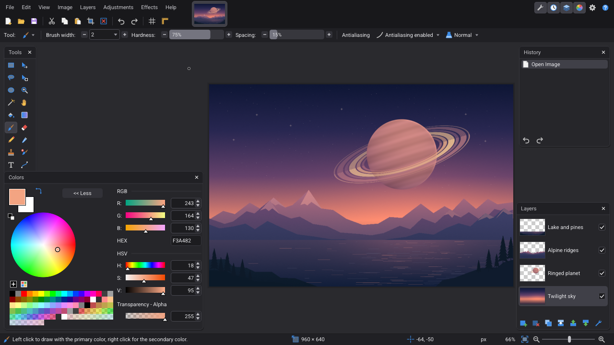

# NT Paint

An open-source, cross-platform clone of [Paint.NET](https://www.getpaint.net/), built with [Natiny](https://natiny.com/) for Windows, macOS, Linux, and the web.

[Download the layered project from the screenshot](examples/orbital-dusk.pdn).
